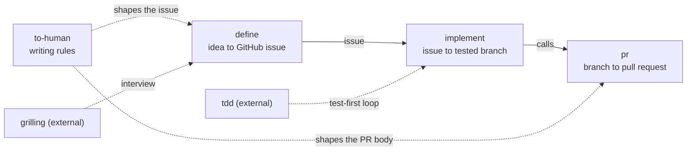

# How `define`, `implement`, `pr` and `to-human` fit together

These four skills turn an idea into a reviewed pull request. They came from [agent-runner](https://github.com/ajorquera/agent-runner) and share one rule: nobody can answer a question late in the chain, so each step writes down what the next one needs.

## The chain

| Step | Skill | Takes | Produces |
|---|---|---|---|
| 1 | `define` | An idea, or the number of an issue marked `needs-definition` | A GitHub issue that follows `define/issue.yml`, with a trace ID in its Links section |
| 2 | `implement` | An issue number | A branch `issue-<n>-<slug>` with passing tests, pushed; or, for an issue that already has an open PR, the reviewer's changes pushed to it |
| 3 | `pr` | A branch, an issue number and optional notes | A pull request whose body follows `pr/pr.yml` |

`implement` calls `pr` itself at the end of a fresh build, so you rarely run `pr` by hand after it. You can still run `pr` on any branch.

## What each one relies on

- **`to-human`** is not a step. It holds the writing rules (summary first, short visible part, details that explain but never decide, one diagram, a one-step confirm). `define` follows it for issues and `pr` for PR bodies. Both stop if it isn't installed.
- **`grilling`** is the interview `define` runs with you. It isn't in this repo. `define` stops if it isn't installed.
- **`tdd`** is the test-first loop `implement` builds with. It isn't in this repo. `implement` stops if it isn't installed.

## How the steps stay linked

- The issue is the contract. `implement` builds only what the issue's Solution, Decisions, Acceptance criteria and Out of scope say, and never asks the human a question. If it can't go on, it stops and comments on the issue or PR.
- `define` writes a trace ID and its session ID into the issue's Links section and posts one trace comment. `pr` carries the trace ID forward in the PR's Links section, so a reviewer can follow the PR back to the issue.
- `define` ships its own scripts (`define/scripts/`): the structure check against the issue template and the trace comment. Run `npm install` there once.

## Installing

Clone this repo and symlink the directories you want into `~/.claude/skills/` (for example `ln -s "$PWD/define" ~/.claude/skills/define`). For the full chain you need `define`, `implement`, `pr` and `to-human`, plus `grilling` and `tdd` from elsewhere.
