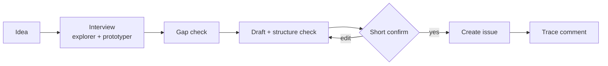

# Define

**Status:** built.

`/define <idea>` turns an idea into a GitHub issue that agents will build from without asking anyone. `/define <issue#>` repairs an issue the template check marked `needs-definition`.

Nobody can answer a question once the issue exists, so Define interviews you first (through the `grilling` skill), writes down every decision, and asks for one "yes" on a short summary: title, type label, summary and decisions. The full draft is saved to a file whose path is printed, so you can read or edit it any time.

## Use it

**New issue.** Run `/define add CSV export to the reports page` inside the target repo.

1. **Interview.** Claude interviews you until you agree on the design. It can search the codebase, or push a throwaway prototype as `proto/<slug>-<n>` when seeing it work settles a decision.
2. **Gap check.** It compares the conversation with the template and asks only about what is missing. It never invents a decision.
3. **Confirm.** You see the short summary and the draft's path. Only "yes" creates the issue; anything else is an edit.
4. **Create.** The issue is created under your own GitHub account, with a type label, a trace ID and a trace comment.

**Rework.** After the template check adds `needs-definition`, run `/define 42`. Define reads what was missing, asks only about that, updates the issue in place and queues it for another run, as described in the agent-runner docs (`docs/implement-review.md`, "Triggers and re-runs"). Editing an issue by hand never starts a run.

Define stops if the `grilling` skill isn't installed or the repo is public.

## The issue template

Defined once in [issue.yml](issue.yml). Define renders from it and the template check grades against it, so they can't drift. The human approves the visible text and the agent builds from everything, including folded notes. **Details can explain; they can't decide.**

| Section | Visible | Folded (agent notes) |
| --- | --- | --- |
| Problem | Why this matters | Not allowed |
| Solution | The shape of the agreed design | The full design |
| Decisions | Each decision, one line | The options rejected and why |
| Acceptance criteria | Testable conditions for done | Not allowed |
| Out of scope | What we decided not to do | Not allowed |
| Links | Trace ID, session ID, prototype branches | Not allowed |

Plus one label, `feature`, `bug` or `refactor`; a `bug` must first get a failing test. Caps: `max_body_chars` 4000 (visible text only) and `max_acceptance_criteria` 8. Writing rules live in [to-human](../to-human/README.md).

## Traceability

Define writes a trace ID, its session ID and any previous trace ID into the issue's Links section, then posts one trace comment with the tokens and subagent calls used. If the transcript can't be read, the comment still posts with `tokens: null`. Define checks the comment landed and retries once. How to read all of it: `docs/traceability.md` in agent-runner.

## Decisions

| Decision | Answer | Rejected and why |
| --- | --- | --- |
| How is the definer packaged? | A skill in the main Claude Code session | Subagent: can't talk to the human. Separate SDK program: loses the session ID and `/resume`. |
| Who creates the issue? | The human, through `gh` | Bot via workflow dispatch or a local App token: more moving parts for a single-maintainer setup |
| What does the trigger check? | Type label and trace ID only | Signed trace ID or maintainer-only label: extra complexity; private target repos cover the risk |
| Where is the template defined? | One `issue.yml`, read by Define and the template check | Issue forms or prose in two places: they drift |
| How does one issue serve a human and an agent? | A visible summary plus folded agent notes, only in Solution and Decisions | A separate agent spec: drifts. Folding any section: the human approves text they never saw. |
| How does the interview work? | The user-level `grilling`, then a gap check | Bundling its own interview: duplicates a trusted skill |
| How does rework work? | `/define <n>` updates the issue in place and adds the re-run label | Listening to `issues.edited`: every typo fix would start a paid run. A new issue: splits the history. |
| Where do prototypes live? | Pushed as `proto/<slug>-<n>`, linked in the issue, deleted once it closes (the cleanup job isn't built) | Local only: Implement can't see them |

## Files

`SKILL.md` (entry point), `DEFINER.md` (full instructions), `issue.yml` (template), `EXPLORER.md` and `PROTOTYPER.md` (helper briefs, handed to built-in subagents), `scripts/` (structure check, quality check, trace comment; run `npm install` there once, then `npm test`), `tests/`.
