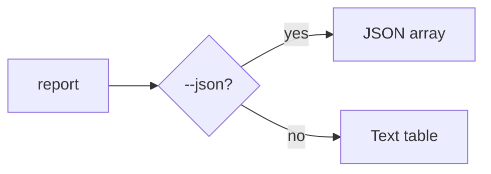

Add a `--json` flag to the `report` CLI so scripts can consume its output. Today the output is human-only text, which forces callers to scrape it.

## Problem

- `report` prints a text table only, so scripts have to parse it.

## Solution

- Add a `--json` flag to `src/cli.js` that prints the rows as a JSON array.
- Reuse the existing row formatter in `src/format.js`.

Agent notes

Follow the argument parsing pattern already used for `--verbose`. Exit code stays 0 on success. Empty result prints `[]`.

## Decisions

- Flag is named `--json`.
- Output is a bare array, not an envelope object.

Agent notes

Rejected: `--format=json` because only one alternative format exists.
Rejected: an envelope object because there is no metadata to carry today.

## Acceptance criteria

- [ ] `report --json` prints valid JSON (`report --json | jq .` exits 0).
- [ ] `report` without the flag output is unchanged (existing test passes).
- [ ] `report --json` on no rows prints `[]`.

## Out of scope

- Other output formats such as CSV.

## Links

Trace ID: `0123456789abcdef0123456789abcdef`
Define session: `01234567-89ab-cdef-0123-456789abcdef`
Prototype: `proto/json-flag-1`
