# Implement

**Status:** built.

```mermaid
flowchart TD
    A["/implement 42"] --> B{Open PR for the issue?}
    B -- no --> C[Branch, then one tdd cycle per behaviour]
    C --> D[Tests pass, push, /pr opens the PR]
    B -- yes --> E[Collect unresolved review feedback]
    E --> F[Fix test-first, push to the PR branch]
    C & E -. stuck .-> G[Comment what a human must decide]
```

`/implement <issue#>` builds a defined GitHub issue test-first and opens a PR through `/pr`. If the issue already has an open PR, it makes the changes the reviewer asked for instead. The issue is the contract, so it never asks you a question: if it can't go on, it stops and says why.

## Use it

Run it in the target repo with a clean working tree. Extra words after the number are notes for it.

- **Fresh:** it creates `issue-<n>-<slug>`, builds every acceptance criterion with the `tdd` skill, runs the tests, pushes, and calls `/pr`. Out of scope stays untouched.
- **Rework:** it picks up unresolved review threads and `CHANGES_REQUESTED` reviews, skips any request that breaks an acceptance criterion or Out of scope (and replies in the thread why), fixes the rest, and pushes.
- **Blocked:** an unclear issue, failing tests or a stuck loop means nothing is pushed and no PR opens. It comments on the issue or PR with what it tried and what you must decide.

It stops without changing anything if the issue number is missing, the `tdd` skill isn't installed, or the working tree is dirty.

In the pipeline, a driver script runs this skill, then a review, in a loop: see `docs/implement-review.md` in agent-runner.

## Why it picks its own seams

`tdd` normally asks you to confirm where tests go. Nobody can answer here, so Implement derives the test seams from the acceptance criteria, writes them down first, tests only there, and lists them in the PR.

## Files

`SKILL.md` (entry point) and `IMPLEMENTER.md` (the full instructions, written for the agent).
