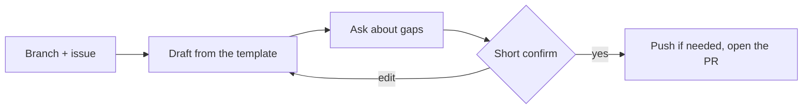

# PR

**Status:** built.

`/pr [issue#] [notes]` writes the pull request for your current branch so a reviewer can read it fast, then opens it after one "yes". The body has a short visible part and folded notes for detail, and it only says what the diff, the commits, the issue or you told it. It never invents a decision or a test result.

## Use it

1. Run `/pr 42` on a branch that is not the default branch. If there are uncommitted changes, it tells you they won't be in the PR.
2. It reads the commits, the diff and the issue, and drafts the body.
3. It asks only about gaps: a decision with no reason, nothing run to verify the change, or an Out of scope it can't confirm.
4. You see the title, the summary and the decisions, plus the draft's path. Reply "yes" to open it; anything else is an edit.

The body follows [pr.yml](pr.yml): Why, What changed, Decisions, How to verify, Out of scope, and Links. The visible part stays under 3000 characters. If the change is too big for that, it tells you to split the PR and doesn't squeeze the text. The writing rules are in [to-human](../to-human/README.md).

It stops if a PR already exists for the branch. In the pipeline, `/implement` calls it.

## Files

`SKILL.md` (entry point), `WRITER.md` (the full instructions, written for the agent) and `pr.yml` (the template).
