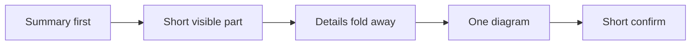

# To human

**Status:** built.

`to-human` holds the house rules for writing anything a person must read, judge and approve: an issue, a PR, a plan. People tire fast, so the visible part is short and complete, and the detail lives in folds. Run `/to-human <file or text>` on any draft to rewrite it to fit, keeping its meaning and adding nothing.

## The rules in short

- **Summary first:** two to four sentences above the first heading, so a reader who stops there knows what this is.
- **Details can explain; they can't decide.** Every decision, scope boundary and done-condition is visible. Folds hold only how and why.
- **Fold only where the template allows,** in one block after the visible part. Headings and machine-read lines stay out.
- **One diagram by default,** unless there is nothing to draw.
- **Never invent.** Anything the sources don't settle is a gap, and gaps are asked about, not guessed.
- **Too big means split,** never squeezed to fit.
- **Confirm in one step:** the few items to approve, the draft's path, and one question. Only "yes" counts.

`define` and `pr` follow these rules, each with its own template and size cap. The full rules are in [SKILL.md](SKILL.md).
